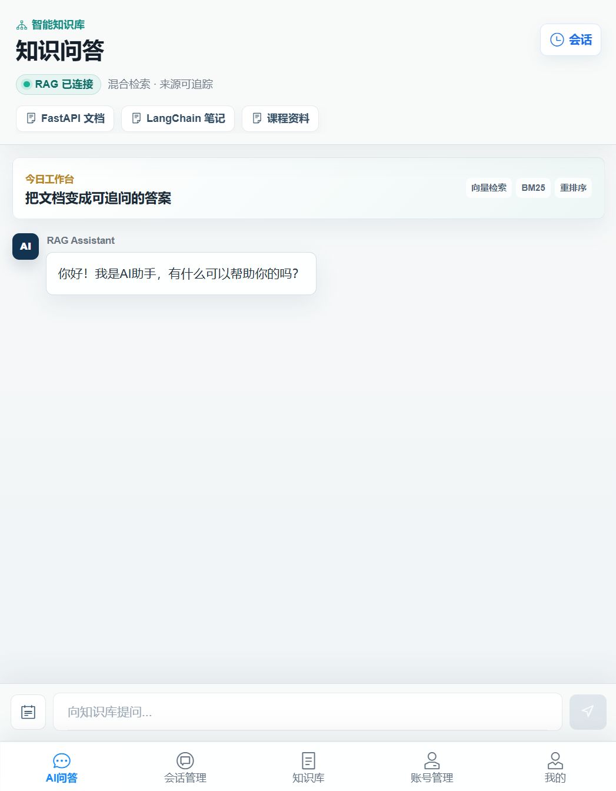
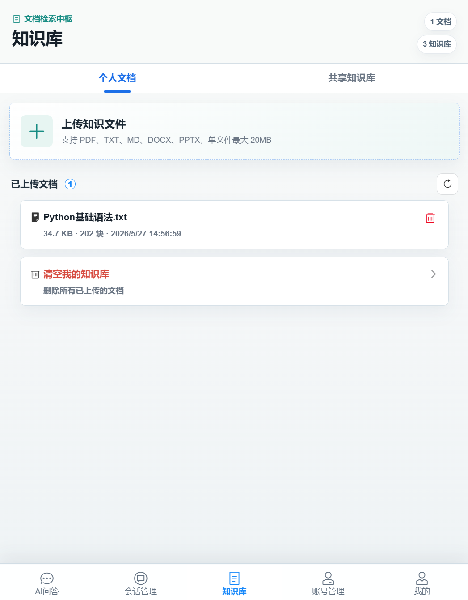
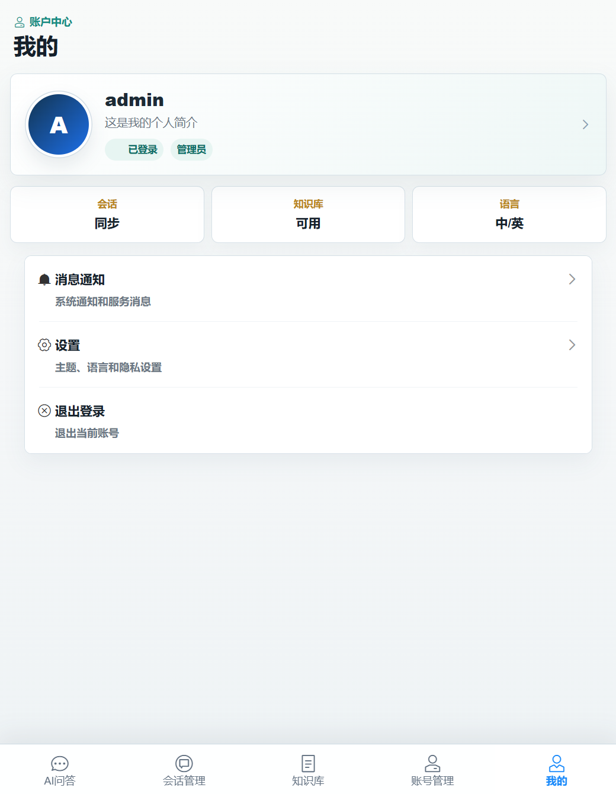
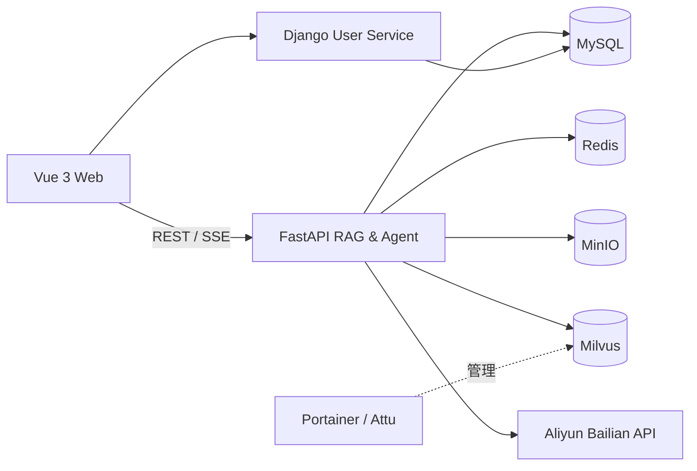

# Group 9 RAG System

第九小组的大模型知识库问答平台。项目提供从多格式文档入库、OCR、分块与向量化，到混合检索、重排、流式问答和引用溯源的一体化 RAG 使用体验，并通过 Docker Compose 完成本地多服务编排。

> 隐私与资源隔离：仓库不包含任何 API Key、个人知识库、数据库文件或运行日志。每位部署者都需要创建自己的 `.env` 并填写自己的百炼 Key；上传的文档和知识库数据只保存在部署者本机的 `data/` 目录与本地 Docker 服务中。

## 功能介绍

### 1. AI 问答工作台



- 新建、搜索、继续和归档历史会话。
- 选择一个或多个知识库后发起问答，并以 SSE 接收流式结果。
- 向量检索与 BM25 关键词检索融合，再通过重排模型提升相关性。
- 展示 RAG 连接状态、检索配置、引用文档和来源段落，便于核验答案。
- 展示 Agent 执行步骤、工具调用结果、运行状态、耗时与 Token 信息。
- 对需要人工确认的 Agent 操作提供批准/拒绝入口。

### 2. 知识库管理台



- 管理个人文档与共享知识库，并按权限控制可见范围。
- 创建知识库、上传文档、刷新状态、删除单个文档或清空个人知识库。
- 支持 PDF、TXT、Markdown、DOCX、PPTX 及常见图片；图片和扫描版 PDF 可走 OCR。
- 文档自动完成解析、父子分块、向量化、对象存储与索引写入。
- 资源概览显示知识库、文档和待处理任务数量；检索结果支持来源追踪。

### 3. 账户中心



- 查看登录状态、角色、个人资料和账号概览。
- 查看会话同步、知识库可用状态与中英文界面配置。
- 提供通知、主题/语言/隐私设置和知识缺口入口。
- 支持切换账号与退出登录；管理员和普通用户拥有不同的知识库权限。

## 技术栈与项目要求匹配情况

| 项目要求 | 本项目实现 | 匹配情况 |
|---|---|---|
| PDF / Word / 图片解析、分块、向量化 | PyPDF、docx2txt、Tesseract OCR、LangChain 文本切分、百炼 `text-embedding-v4` | 已满足 |
| 流式 RAG 问答与引用溯源 | FastAPI `StreamingResponse` + 前端 SSE/ReadableStream；回答携带文档及段落来源 | 已满足 |
| 权限隔离 | Django 用户/角色体系，个人与共享知识库按用户和权限控制可见性 | 已满足 |
| 后端 Python + FastAPI | Python 3.12、FastAPI、Uvicorn；Django 独立负责用户服务 | 已满足 |
| 对象存储、日志与资源监控 | MinIO、结构化日志、健康检查、Portainer | 已满足 |
| 向量数据库 | Milvus，Attu 提供可视化管理 | 已满足 |
| React / Vue + SSE | Vue 3、Vite、Pinia、Vant、Nginx，支持流式输出 | 已满足 |
| MySQL / PostgreSQL | MySQL；Redis 用于缓存和会话辅助 | 已满足 |
| Docker + Compose + Portainer | 多服务 Docker Compose 编排并集成 Portainer | 已满足 |
| 本地模型或大模型 API | 阿里云百炼 `qwen-plus`、`text-embedding-v4`、`qwen3-vl-rerank` | 已满足 |
| 评测体系 | 覆盖检索 Recall@K/MRR、路由准确率、断言、忠实度、覆盖率、延迟与 Token 的评测框架和固定测试集 | 已满足核心量化能力；任意文档自动生成问答集仍可继续增强 |

除此之外，项目还使用 LangGraph 构建 Agent 工作流，以 BM25 + Milvus 实现混合检索，并加入父子分块、重排、知识缺口记录和人工审批能力。

## 系统架构



## 快速部署到本地

### 前置条件

- Git for Windows 2.40+（Linux/macOS 使用对应平台的 Git）
- Docker Desktop 4.x，Windows 建议启用 WSL 2 后端
- 自己申请的阿里云百炼 API Key
- 建议为 Docker 预留至少 15 GB 空间；首次构建需要下载镜像和依赖

宿主机不需要单独安装 Python、Node.js、MySQL、Redis、MinIO 或 Milvus。

### 1. 获取项目

```powershell
git clone https://github.com/baixigua/group-9-rag-system.git
cd group-9-rag-system
```

### 2. 创建个人配置

Windows PowerShell：

```powershell
Copy-Item .env.example .env
```

Linux/macOS：

```bash
cp .env.example .env
```

打开 `.env` 并至少完成以下修改：

```dotenv
# 必须使用部署者自己的百炼 Key
ALIYUN_ACCESS_KEY_SECRET=your-own-bailian-api-key

# 必须替换为部署者自己的强密码/随机值
MYSQL_ROOT_PASSWORD=your-own-mysql-password
JWT_SECRET_KEY=your-own-random-string-at-least-32-characters
MINIO_ROOT_USER=your-own-minio-user
MINIO_ROOT_PASSWORD=your-own-minio-password
```

如能直连百炼，保持 `OUTBOUND_PROXY=` 为空。只有需要 Clash Verge 代理时，才填写：

```dotenv
OUTBOUND_PROXY=http://host.docker.internal:7897
```

### 3. 启动全部服务

```powershell
docker compose config --quiet
docker compose up -d --build
docker compose ps
```

当主要服务状态为 `running`/`healthy` 后，打开：

| 服务 | 地址 |
|---|---|
| Web 前端 | <http://127.0.0.1:3000> |
| FastAPI 文档 | <http://127.0.0.1:8000/docs> |
| Django API 文档 | <http://127.0.0.1:8001/docs/> |
| MinIO 控制台 | <http://127.0.0.1:9001> |
| Attu（Milvus 管理） | <http://127.0.0.1:8080> |
| Portainer | <https://127.0.0.1:9443> |

就绪检查：

```powershell
Invoke-RestMethod http://127.0.0.1:8000/health/ready
```

### 4. 开始使用

1. 打开 Web 前端，注册并登录自己的账号。
2. 进入“知识库”，创建个人知识库并上传文档。
3. 等待解析和索引完成，进入“AI 问答”并选择知识库。
4. 输入问题，检查流式回答下方的引用来源和 Agent 执行信息。

### 停止服务

```powershell
# 停止但保留容器与数据
docker compose stop

# 移除容器但保留 data/ 中的数据
docker compose down
```

不要随意删除 `data/`。该目录保存当前部署者的数据库、对象文件和向量数据。

## 为什么组员不会占用仓库发布者的资源

- `.env` 已加入 `.gitignore`，真实百炼 Key 不会被提交；`.env.example` 只有空值和占位值。
- 每位组员必须在自己的电脑创建 `.env`，因此 API 调用计入其自己的百炼账号。
- Compose 使用相对路径 `./data/...` 挂载数据库、对象存储和向量库，每台电脑拥有独立数据副本。
- 所有宿主端口默认只绑定 `127.0.0.1`，不会把数据库服务直接暴露到局域网。
- 仓库不包含已上传文档、聊天记录、日志、Docker 数据卷或用户账户数据。

## 核心技术栈

- **前端：** Vue 3、Vite、Pinia、Vant、Nginx
- **RAG / Agent：** LangChain、LangGraph、BM25、Milvus、百炼模型 API
- **后端：** FastAPI、Django REST Framework、SQLAlchemy
- **数据设施：** MySQL、Redis、MinIO、Milvus
- **文档处理：** PyPDF、docx2txt、Tesseract OCR、Pillow
- **部署与运维：** Docker、Docker Compose、Portainer、Attu

## 项目结构

```text
.
├─ front/                 # Vue 前端
├─ backend/               # FastAPI、RAG、Agent、评测与测试
├─ DjangoUserService/     # 用户、认证与权限服务
├─ docker/                # 数据库等容器初始化配置
├─ docs/                  # 设计、测试语料与产品图片
├─ compose.yml            # 完整本地编排
├─ .env.example           # 无敏感信息的配置模板
└─ LOCAL_SETUP.md         # 更详细的 Windows 本地运行指南
```

## 测试与评测

后端测试覆盖文档入库、权限、检索、Agent、流式问答和评测工具。评测数据位于 `backend/eval/datasets/`，指标实现位于 `backend/eval/`。

常用诊断命令：

```powershell
docker compose ps
docker compose logs --tail 100 api
docker compose logs --tail 100 django
docker compose logs --tail 100 milvus
```

完整 Windows 操作与排错说明见 [LOCAL_SETUP.md](LOCAL_SETUP.md)。
